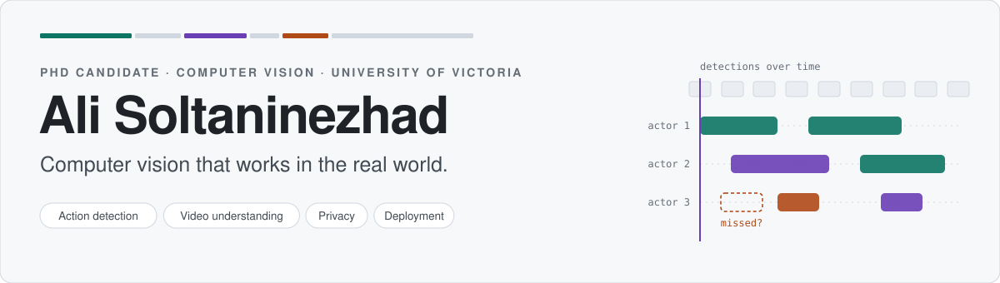
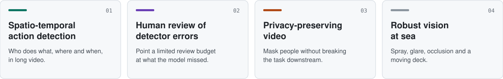
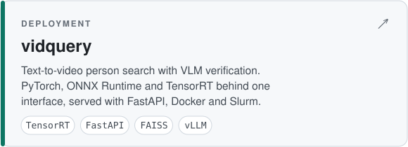
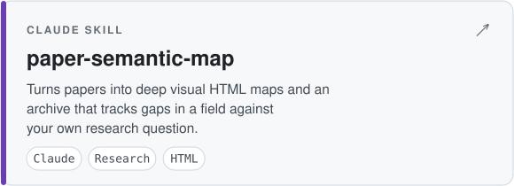
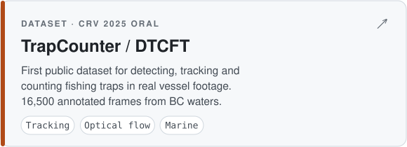
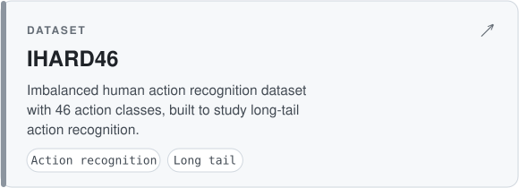
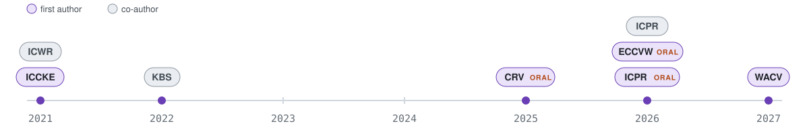
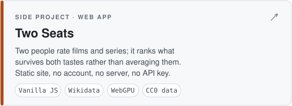

<picture>
  <source media="(prefers-color-scheme: dark)" srcset="assets/header-dark.svg">
  
</picture>

  
  
  
  
  

## About

I'm a PhD candidate in Electrical and Computer Engineering at the **University of Victoria**, in Dr. Alexandra Branzan Albu's Computer Vision Lab. I build video understanding systems that keep working outside the lab: on commercial fishing vessels, on edge hardware, and with a person in the loop. My research feeds **FishVue**, Archipelago Marine Research's at-sea monitoring platform. PhD expected April 2027.

## Research

<picture>
  <source media="(prefers-color-scheme: dark)" srcset="assets/research-dark.svg">
  
</picture>

## Featured work

<table>
  <tr>
    <td width="50%"><a href="https://github.com/alisoltani7596/vidquery"><picture><source media="(prefers-color-scheme: dark)" srcset="assets/card-vidquery-dark.svg"></picture></a></td>
    <td width="50%"><a href="https://github.com/alisoltani7596/paper-semantic-map"><picture><source media="(prefers-color-scheme: dark)" srcset="assets/card-paper-semantic-map-dark.svg"></picture></a></td>
  </tr>
  <tr>
    <td width="50%"><a href="https://github.com/alisoltani7596/TrapCounter"><picture><source media="(prefers-color-scheme: dark)" srcset="assets/card-trapcounter-dark.svg"></picture></a></td>
    <td width="50%"><a href="https://github.com/alisoltani7596/IHARD46"><picture><source media="(prefers-color-scheme: dark)" srcset="assets/card-ihard46-dark.svg"></picture></a></td>
  </tr>
</table>

## Publications

<picture>
  <source media="(prefers-color-scheme: dark)" srcset="assets/timeline-dark.svg">
  
</picture>

**First author**

| Year | Paper | Venue |
|:---:|---|---|
| 2027 | **Missed-Event Routing for Temporal Action Detection** | WACV, accepted |
| 2026 | [**Error-Aware Reviewer Guidance for AI-Assisted Fisheries Electronic Monitoring**](https://openreview.net/forum?id=1cmuiiSYVa) | ECCV Workshops, Marine Vision · Oral |
| 2026 | [**TubeLite: Lightweight Multi-Actor Spatio-Temporal Action Detection**](https://link.springer.com/chapter/10.1007/978-3-032-31663-9_46) | ICPR · Oral |
| 2025 | [**TrapCounter: Integrating Detection, Tracking and Optical Flow for the Automatic Counting of Active Fishing Traps**](https://crv.pubpub.org/pub/y0r9m3dn/release/1) | CRV · Oral |
| 2021 | [To Transfer or Not To Transfer (TNT): Action Recognition in Still Image Using Transfer Learning](https://ieeexplore.ieee.org/document/9721468) | ICCKE |

**Co-author**

| Year | Paper | Venue |
|:---:|---|---|
| 2026 | [Quilting-based Image Pre-processing for Commercial Ground Hook and Line Fishing Imagery Classification](https://link.springer.com/chapter/10.1007/978-3-032-31666-0_2) | ICPR |
| 2022 | [Multi-Expert Human Action Recognition with Hierarchical Super-Class Learning](https://www.sciencedirect.com/science/article/pii/S0950705122005378) | Knowledge-Based Systems |
| 2021 | [Still Image Action Recognition Using Ensemble Learning](https://ieeexplore.ieee.org/abstract/document/9443021) | ICWR |

## Industry impact

**FishVue** · Archipelago Marine Research 
Catch and compliance monitoring on commercial fishing vessels. My research on trap counting, discard detection and reviewer guidance feeds the platform, which won the [2026 VIATEC Innovative Excellence Award](https://www.archipelago.ca/archipelago-wins-innovative-excellence-viatec-2026-fishvue-ai).

**Applied AI Specialist** · Wireless PnC 
Computer vision for drones and robots at a Victoria wireless-charging startup (2026 onward).

## Side projects

Things I build outside the lab.

<table>
  <tr>
    <td width="50%"><a href="https://github.com/alisoltani7596/two-seats"><picture><source media="(prefers-color-scheme: dark)" srcset="assets/card-twoseats-dark.svg"></picture></a></td>
    <td width="50%" valign="top">
      
<b><a href="https://alisoltani7596.github.io/two-seats/">Open the app</a></b> &nbsp;·&nbsp; <a href="https://github.com/alisoltani7596/two-seats">source</a>

      
Picking something to watch with another person is not a ranking problem. A top-rated list suits neither of you, and averaging two tastes gives a bland middle nobody asked for. Two Seats scores a title as the mean of both fits <i>minus</i> how far apart they are, so something one of you would love and the other would hate ranks below something you both merely like.

      
Everything runs in the browser: ratings in local storage, a share link that packs one person's ratings into the URL fragment so two phones can combine them, and an optional on-device language model for plain-English search. The 14,000-title dataset is built from Wikidata rather than IMDb, whose terms do not cover republishing derived data.

    </td>
  </tr>
</table>

## Toolbox

<table>
  <tr>
    <td><b>Research</b></td>
    <td>
      
      
      
      
      
    </td>
  </tr>
  <tr>
    <td><b>Deployment</b></td>
    <td>
      
      
      
      
      
      
    </td>
  </tr>
  <tr>
    <td><b>Compute</b></td>
    <td>
      
      
      
      
    </td>
  </tr>
</table>

## Teaching

**Course instructor**, ECE 435 / BME 403 Medical Image Processing, UVic (2026). **Super TA** for ECE 471 Computer Vision and ECE 537 Applied Data Analysis, and **lab instructor / TA** across five more UVic ECE courses since 2023.

## Honours

**President's Fellowship** in Research-Enriched Teaching, UVic (2025) · **Top 1%** nationally, BSc entrance exam · **Top 3%** nationally, MSc entrance exam

<picture>
  <source media="(prefers-color-scheme: dark)" srcset="assets/footer-dark.svg">
  
</picture>
